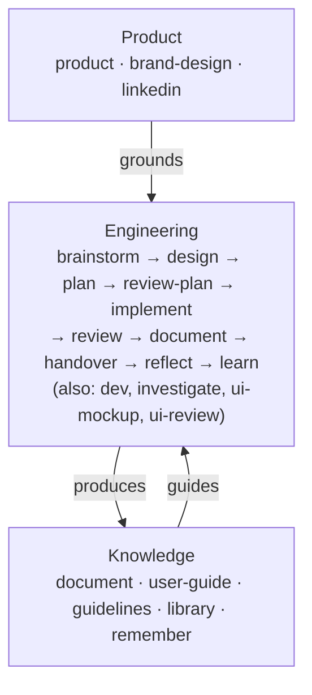

# Bob

AI knows how to write good code. The problem is it rarely does - unless you give it a reason to.

Bob is a set of [Agent Skills](https://agentskills.io) that bring discipline to AI-assisted product development - from strategic discovery through shipped, tested, documented code. Each skill loads the right principles, reads the right context, follows the right process. Reliably, every time.

**Two independent layers:** Product strategy skills (vision, validation, business model, positioning) and engineering skills (brainstorm, plan, implement, review). Use one, use both, or start where it matters most to you.

Language-agnostic. Works across any stack. Built to the Agent Skills spec; tested in Claude Code.

👉 [Homepage](https://bob.bofrese.dk/) · [User Guide](docs/user-guide/index.md) · [Presentation](https://bob.bofrese.dk/presentation/index.html)

---

## The Problem

Three things that happen when you work with AI without structure:

**AI defaults to average.** It *knows* world-class principles - BDD, DDD, clean architecture. But when you just ask it to solve a problem, it writes like the average programmer it was trained on. Without the right frameworks loaded at the right moment, you get competent code. Not principled code.

**AI is a pleaser.** It agrees with you. Applauds your thinking. Confirms you're right. The longer the conversation, the less likely it pushes back on a bad idea. You need critical distance - and you need it built into the workflow, not hoped for.

**Context disappears.** For an AI, it's day one in your project every session. You know how it feels to join a new project - the guessing, the questions, slowly piecing together why things were built the way they were. For an AI, that's every conversation. New session, new employee. If you have to re-introduce your codebase every time you open Claude, you've already lost the productivity benefit.

Bob solves all three. Deliberately. By design.

---

## Philosophy

This isn't a toolkit that runs commands for you. It's a toolkit that thinks *with* you.

- **Use what you need.** Discovery and Engineering are independent layers. Use the product skills for strategy work. Use the engineering skills for development workflows. Use both together for the full lifecycle. They amplify each other but don't require each other.
- **Phases, not ambient magic.** Each skill is one phase: `/bob:plan`, `/bob:review`, `/bob:implement`. When a phase runs, the AI knows exactly what you are doing. It loads the right principles, reads the right context, follows the right process. You can also just describe your work: the `bob` hub skill and a session primer make sure the right phase starts.
- **Files are the memory.** Everything persists in git - vision, plans, decisions, guidelines. Context survives across sessions, branches, and people. Close your laptop. Come back tomorrow. Hand off to a colleague. The project remembers.
- **Session boundaries create honesty.** A plan written in one session is reviewed in another - by a fresh context with no memory of the conversation that produced it. That's how you get genuine critique instead of polite agreement.
- **Quality holds up over time.** The tenth feature gets the same disciplined treatment as the first. Guidelines get checked. Principles get applied. Technical debt doesn't silently accumulate.
- **You own the code.** The goal isn't AI that writes code *for* you. It's AI that helps you do better work. You understand every line. You made the decisions. You could walk away from AI entirely and still maintain what you built.

---

## User Guide

The full story - how the skills connect, how memory works, how a feature travels from idea to shipped code - is all in one place:

👉 [Read the User Guide](docs/user-guide/index.md)   
👉 [See the Homepage](https://bob.bofrese.dk/)   
👉 [See the Presentation](https://bob.bofrese.dk/presentation/)  

---

## How to use it

**Just describe your work.** In a project that uses bob, a SessionStart hook adds a short primer, and the `bob` hub skill loads before work starts: it resolves the story, loads project knowledge and names the fitting phase. "Plan the export feature" or "this test fails, find out why" is enough.

**Or call a phase directly** with a slash command: `/bob:plan`, `/bob:review`, `/bob:product`. Skills are the only entry point; there are no separate commands.

**Not sure?** Ask "Bob, where are we and what next?" - the `bob` hub skill gives a status and the next phase.



**Product** - `product` coaches discovery and keeps `docs/product/` current: vision, problem space, personas, validation plan, business model, positioning, go-to-market. `brand-design` and `linkedin` cover design direction and LinkedIn growth.

**Engineering** - the engineering loop: brainstorm → design → plan → [review-plan] → implement → review → document → handover → reflect → learn. `dev` is the short path for small, settled changes; `investigate` finds root causes; `ui-mockup` designs screens and pages as visual mockups with a spec beside them; `ui-review` critiques interfaces.

**Knowledge** - notes that accumulate and make future sessions better: `document` for architecture notes, `user-guide` for end-user guides, `guidelines` for best practices, `library` for the knowledge vault, `remember` for quick capture.

## Skills

Generated from the skill frontmatter by `python3 scripts/check.py --write-readme`.

<!-- skills:start -->

**Hub**

| Skill | Description |
|---|---|
| `bob` | Hub of bob, the product development workflow. Start and finish checklists for every bob phase (story tracking, project knowledge, done criteria, next phase). Use when a bob skill says so, when the user asks about bob, or for engineering or product work in a repo using bob, even if bob is not named. |

**Engineering phases**

| Skill | Description |
|---|---|
| `autopilot` | Bob's autopilot. Runs stories whose design is settled end to end without the developer: plan, review-plan, implement, review, document, commit, handover, each phase in its own subagent. Use only when the user asks to autopilot, auto-run or resume an autopilot run. |
| `brainstorm` | Bob's brainstorm phase. Coaches a guided feature brainstorm (seed, diverge, converge, detail, commit) and writes a Brainstorm Brief. Use when value, outcome or problem framing of an idea is open. Explores outcomes only, never architecture or code. |
| `design` | Bob's design phase. Forms and defends the simplest coherent conceptual design for a capability, grounded in repository evidence, and writes a Design Record. Socratic and human-owned. Use when concepts, boundaries, naming or whole-system fit are open, before planning. |
| `dev` | Bob's dev phase. A peer working session for code discussion, quick fixes and direct changes, without the brainstorm, plan and review cycle. Use only when the user asks for a direct change or quick fix. Escalates to design when a change outgrows the fast path. |
| `document` | Bob's document phase. Writes and maintains a project's canonical architecture notes (concepts, patterns, README index) in docs/architecture/, in Discover, Update or Audit mode. Use when architecture notes must reflect the code, after review or to check drift. Never changes application code. |
| `explain` | Bob's explain phase. Builds a self-contained interactive HTML explainer so an experienced developer understands a software topic or part of their own system: predict, see, try. Outline gate first. Use when the user asks for an explainer, interactive explanation or visual tutorial. |
| `handover` | Bob's handover phase. Narrates a delivered change for approval instead of a pull request (the full diff in reading order, with the reasoning at each place) so the accountable developer can own it. Coverage-checked. Use when delegated work must be owned by the human, after document, before reflect. |
| `implement` | Bob's implement phase. Executes an approved Plan autonomously with tests at every step, and pauses when evidence shows the design does not fit reality. Use only when the user asks to implement a plan or to start building from one. |
| `investigate` | Bob's investigate phase. Systematic bug investigation (hypotheses, code tracing, 5 Whys, impact, fix options) that finds the root cause and writes a report. Use when a bug, error or failing test needs a root cause rather than a quick fix, or the user asks why something fails. Never implements fixes. |
| `learn` | Bob's learn phase. Analyzes evidence from completed work and recommends small, durable improvements to the AI development harness without instruction accretion. Scoped mode improves one skill or command. Use when a session exposed a reusable harness lesson, or to improve a skill after using it. |
| `plan` | Bob's plan phase. Translates a Design Record into a reviewable Plan - step order, refactoring, files, tests, risks - ready for a developer or AI handoff. Use when the user asks how to build something already designed, or wants a plan before coding. Plans only, never implements. |
| `reflect` | Bob's reflect phase. A short, peer-to-peer reflection after the developer reads the Handover, recovering implementation insight and closing ownership gaps in a Reflection Record. Use after reading the Handover, or when the implementation surprised the developer. |
| `review` | Bob's code review phase. Reviews code changes from git against the plan, Design Record, guidelines and done criteria (bugs, design conformance, design concerns, system health). Use for a code review of changes, a branch or a PR, or when correctness must be checked independently. Reports only. |
| `review-plan` | Bob's plan review phase. Critically and independently reviews a Plan against the codebase and Design Record (gaps, simpler solutions, security, misalignment) and writes a verdict. Use when facts or risk justify an independent check of a plan. Reviews only, never edits the plan. |
| `ui-review` | Bob's UI review phase. Expert UI/UX critique of a screen, flow, component or app (from screenshots or code) against design principles and product artifacts, with ranked fix options and optional implementation. Use when a UI needs an expert review. Implements only on explicit request. |

**Product**

| Skill | Description |
|---|---|
| `brand-design` | Bob's brand and design direction coach. Writes the product design brief (goals, principles, tone, voice) and gives art direction for UI, brand, web and marketing visuals (colour, typography, layout). Use for design direction, visual identity or look-and-feel questions. |
| `linkedin` | Bob's LinkedIn growth advisor for consultants, founders and B2B service businesses. Builds LinkedIn strategy (content pillars, posts, comments, DMs, profile, algorithm) grounded in the product's positioning and personas. Use for LinkedIn marketing, personal branding or thought leadership. |
| `product` | Bob's product coach. Guides product discovery and keeps docs/product/ current - vision, personas, problem space, validation plan, business model, pricing, positioning and go-to-market. Use for product or business strategy work, or to find gaps in the product docs. |

**Knowledge and meta**

| Skill | Description |
|---|---|
| `docker-setup` | Bob's Docker dev environment builder. Creates or updates Dockerfile, docker-compose, Makefile targets and install docs, then verifies the environment really runs. Use only when the user asks to set up, fix or maintain a Docker development environment. |
| `guidelines` | Bob's guideline writer. Creates and maintains short best-practice guidelines in docs/guidelines/ for the project's languages, frameworks and concepts, researched from authoritative sources. Use when the user wants coding guidelines, technology pitfalls or linter setup written down. |
| `library` | Bob's knowledge vault librarian for knowledge/. Processes the inbox into atomic notes, ingests external sources (URL or file), searches notes, runs vault health checks, shows status, and bootstraps the vault. Use when the user wants to file, find or organise project knowledge. |
| `new-skill` | Bob's skill author. Designs and creates a new Agent Skills spec-compliant skill for bob or for the current project - proposal questions, design, SKILL.md and references, validation, README catalog. Use when the user wants to add a skill, a bob phase or a slash command. |
| `remember` | Bob's quick capture. Writes a thought, decision or insight straight to the knowledge inbox (knowledge/_INBOX/) without loading context or running a phase. Use when the user says "remember this", "note that" or wants to capture something mid-session for later filing. |
| `review-skill` | Bob's skill reviewer. Reviews an Agent Skill for spec compliance, description triggering, progressive disclosure, token efficiency and clarity, and proposes a leaner version. Use when the user wants a skill, prompt or slash command checked or optimised. Reviews only, never edits the skill. |
| `setup` | Bob's project setup. Bootstraps and upgrades bob infrastructure in a project - projects/, knowledge vault, done criteria, story structure repairs, recommended tools. Idempotent and non-destructive. Use only when the user asks to set up, install or upgrade bob in a project. |
| `ui-mockup` | Bob's UI mockup phase. Designs app screens, web pages or flows as visual mockups (Claude Design canvas, local HTML, Figma exports) with a living spec beside them, then hands them to builders with screenshots and a code map. Use when a UI must be designed visually before it is built. |
| `user-guide` | Bob's user guide writer. Creates or maintains an end-user guide for the current project from what the code really does, and reports UX gaps and missing features as separate findings. Use when the user wants end-user documentation written, updated or checked for drift. |

**Principles**

| Skill | Description |
|---|---|
| `architect` | Bob's architecture judgment - whole-system comprehensibility lenses, domain placement, deep modules, interfaces, source readability, concept identification, design smells, codebase patterns and drift. Use when judging a design, an abstraction, where code belongs, or architectural fit. |
| `bdd` | Bob's behaviour-driven development principles - Given/When/Then acceptance criteria, testing behaviour not implementation, and the golden done check. Use when defining acceptance criteria or a testing strategy, or when judging whether work is done. |
| `obsidian` | Bob's Obsidian vault operations - moves and renames .md files so links stay intact (Obsidian CLI, or a link-rewriting script without it), and searches the vault. Use before any mv or git mv of a markdown file, or when the user mentions Obsidian, wikilinks, internal links or vault search. |
| `ui-design` | Bob's UI design principles - 14 expert lenses (hierarchy, cognitive load, states, typography, Gestalt, touch targets, motion, noise, consistency, emotion, platform, context, brand, whole system) and a final check. Use when designing a user interface or writing UI code. For critique, use ui-review. |

<!-- skills:end -->

---

## What is new in 4.0.0

- **Skills only.** `commands/` is gone. The 58 listing entries (commands plus skills) are now 29 skills. Every skill follows the Agent Skills spec.
- **The `bob` hub.** One skill holds the start and finish checklists that every phase shares (story, project knowledge, done criteria, next phase). It replaces the eight protocol skills and `pm`.
- **Status line and knowledge pane** (Unreleased). The status line shows the last bob phase and the active story, for example `bob: plan · BOB-12 (7 loaded, /bob-knowledge)`. `/bob-knowledge` lists the skills, bob references and project docs loaded this session.
- **Primer hook.** A SessionStart hook tells the agent that a bob project starts with the hub, so you do not have to remember to call it. `setup` also writes a short bob block into `AGENTS.md` for Codex and Copilot.
- **Fewer, bigger skills.** Seven product commands became modes of `product`; two design commands became modes of `brand-design`.
- **Bug fixes** (from 3.1.1): the markdown-move guard only blocks when Obsidian and its CLI are present; `ai/reviews/` no longer ships inside the plugin.

Details: [CHANGELOG.md](CHANGELOG.md).

## Upgrading from 3.x

Project files (`docs/`, `projects/`, `knowledge/`) are unchanged. What changed are the names. Run `/bob:setup` in your project: it scans `CLAUDE.md`, `AGENTS.md`, `docs/process/*.md` and `docs/guidelines/` for old names, shows each hit with its replacement, and offers to fix them.

| Old | New |
|---|---|
| product-coach, product-vision, personas, problem-space, validation-plan, business-plan, positioning | `product` (mode) |
| design-brief, art-director | `brand-design` (mode) |
| new-command, review-command | `new-skill`, `review-skill` |
| improve-command | `learn` (scoped mode) |
| pm | `bob` |
| create-prompt | removed |

---

## Project Knowledge

Bob's value compounds over time because every session writes to a shared, persistent file system. When you open a new session tomorrow, everything from today is already there.

| Location | What lives here |
|---|---|
| `docs/product/` | Strategy artifacts: vision, problem space, personas, business plan, positioning, validation plan, design brief. Maintained by the product skill; used by engineering skills to ground their work. |
| `docs/architecture/` | Canonical architecture knowledge: one small note per system concept (`concepts/`) and codebase pattern (`patterns/`), indexed by `README.md`. Written by `/bob:document`; loaded by scope in engineering sessions. |
| `docs/guidelines/` | Technology best practices - researched from authoritative sources, applied to your stack. Engineering skills load only the guidelines relevant to the work at hand. |
| `docs/domain/` | Project-specific terminology. Corrections, non-obvious distinctions, context-specific meanings. Captured when AI misunderstands something that a domain expert would know. |
| `docs/process/done-criteria.md` | The project's evolving definition of done. Auto-bootstrapped on first run; grows as more skills are used. |
| `docs/process/learnings.md` | `learn`'s cross-session staging log - occurrences seen once, not yet confirmed as a pattern. A second credible occurrence becomes a harness candidate. |
| `projects/{name}/stories/{ID}/` | Session artifacts - designs, plans, reviews, implementations, handovers, investigations, brainstorms. Organized by story. The project's decision log: they explain *why* things were built the way they were. |
| `knowledge/` | Working knowledge vault: decisions, research and anything that fits nowhere more specific. Loaded into context by every engineering skill. Managed by `/bob:library`; quick capture via `/bob:remember`. |
| `personal/` | Personal daily notes, weekly digests, scratchpad. Gitignored - never committed. Written by the `bob` hub's finish checklist at the end of every session. |

This is the memory layer. The reason `review` can check a feature against its plan. The reason `implement` knows what patterns to follow. The reason a fresh session isn't starting from scratch.

---

## Installation

**In claude code:** 

```claude 
/plugin marketplace add bofrese/claude-plugins
/plugin install bob@bofrese-plugins
```

See more on [finding and installing claude plugins here](https://code.claude.com/docs/en/discover-plugins)

**Recommended companions** (`/bob:setup` recommends both if missing):

**[Ponytail](https://ponytail.dev)** - a "lazy senior developer" reviewer that keeps code lean. `/bob:review` runs `/ponytail-review` as an over-engineering pass when it is installed.

```claude
/plugin marketplace add DietrichGebert/ponytail
/plugin install ponytail@ponytail
```

**[Obsidian Skills](https://github.com/kepano/obsidian-skills)** - authoring skills for Obsidian-flavored markdown, Bases, and Canvas. Bob is optimized for Obsidian and produces better-formatted notes when it is present. (Bob's own `bob:obsidian` skill stays authoritative for vault mutations like rename/move.)

```claude
/plugin marketplace add kepano/obsidian-skills
/plugin install obsidian@obsidian-skills
```

**graphify** - builds a persistent code knowledge graph that bob's engineering skills query (the `bob` hub's code-graph step) to orient from real structure instead of blind exploration. `/bob:setup` recommends it, offers to build the graph and install the post-commit auto-rebuild hook, and writes a scoped `.graphifyignore`. bob requires **>= 0.9.11**; everything degrades gracefully when graphify is absent.

```bash
uv tool install graphifyy   # package is "graphifyy" (double-y), not a typo
```

**Mermaid CLI** - validates the Mermaid diagrams bob writes in designs, plans and architecture notes. Mermaid fails silently in many renderers, so bob checks each file with `mmdc` before saving when it is installed. `/bob:setup` recommends it.

```bash
npm install -g @mermaid-js/mermaid-cli   # needs Node.js
```

### Developing Bob

To work on bob itself, clone the repo and pass the directory as a plugin when starting Claude:

```bash
git clone https://github.com/bofrese/bob.git
cd bob
claude --plugin-dir .
```

An alias makes this faster:

```bash
# Add to ~/.zshrc or ~/.bashrc
alias claude-bob='claude --plugin-dir ~/path/to/bob'
```

With the alias, `claude-bob` anywhere opens Claude with your local Bob loaded - changes take effect immediately without reinstalling.

---

## Quick Start

After installation, mention Bob by name:

```claude
Hi Bob, what can you help with? How do we get started?
```

**Common starting points:**
- **First time on a project?** `/bob:setup` bootstraps bob infrastructure (idempotent - safe to run again after updates)
- **Product strategy work?** `/bob:product`
- **New feature?** `/bob:brainstorm` → `/bob:design` → `/bob:plan` → `/bob:implement` → `/bob:review`
- **Quick fix or code discussion?** `/bob:dev` - direct working session, no full loop
- **Inherited codebase?** `/bob:document` (Discover) to map its concepts and patterns
- **Not sure?** Ask "Bob" - the `bob` hub names the next phase

---

## Contributing

This is a living toolkit - continuously evolving. New skills, sharper existing ones, better patterns. Never finished, and that's by design.

Pull requests are welcome. Bob is opinionated, and the opinions are deliberate. A PR might land as-is, get adapted, or get a respectful decline - not because your idea is wrong, but because it doesn't fit the direction. You're welcome to have strong opinions too; that's what makes contributions worth having.

Even if you're not sure a PR will land exactly as written: it's visible. Other people can see it, learn from it, build on it. That has value on its own.

If you use bob, feedback is genuinely useful. What works? What doesn't? What's missing? What surprised you? All of it helps shape where this goes:

👉 [GitHub Discussions](https://github.com/bofrese/bob/discussions)

Skill authoring rules: [skills/new-skill/references/authoring-rules.md](skills/new-skill/references/authoring-rules.md).

---

## License

This project is licensed under the **Apache License 2.0**.

Apache 2.0 means you can use, modify, and distribute this toolkit - commercially or otherwise - for any project. The one thing that must travel with it: the copyright and attribution notice. That's it. No copyleft. No share-alike. No restrictions on what you build with it.

See the [LICENSE](LICENSE) file for the full legal text.

---

## Attribution

Created by **[Bo Frese](https://bofrese.dk)** - [bofrese.dk](https://bofrese.dk)

---

## About the Author

Bo works at the intersection of software development and agile process design - with a particular focus on how teams can integrate AI tools effectively into their workflows without losing the things that make good development good: human judgment, architectural discipline, and the ability to actually understand what you're shipping.

If you're looking for hands-on development help, or if your team wants to think more carefully about how AI fits into your process, Bo is available for both. More at [bofrese.dk/ai](https://bofrese.dk/ai) 
