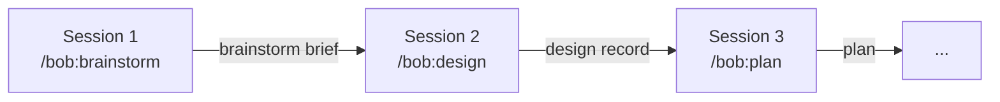

# Getting started
*Last updated: 2026-10-14*

This chapter takes you from installation to your first finished session.

## Install

```
/plugin marketplace add bofrese/claude-plugins
/plugin install bob@bofrese-plugins
```

Bob depends on the `plain-writing` plugin from the same marketplace. It holds the writing rules for every file bob writes.

To update later, run `/plugin update`, then run `/bob:setup` in each project. Setup also finds and fixes skill names from bob 3.x.

Optional companions that `/bob:setup` recommends: Ponytail (an over-engineering pass in code review), Obsidian Skills, graphify (a code knowledge graph) and the Mermaid CLI (diagram validation). The [README](../../README.md#installation) has the install commands.

## Your first session

1. Open Claude Code in your project:
   ```bash
   cd /path/to/your/project
   claude
   ```
2. Run `/bob:setup`. It audits the project, shows what is missing and creates it after one confirmation. It is safe to run again at any time.
3. Ask "Bob, where are we and what next?" or run `/bob:bob`. The hub reads your boards and recommends one next step.
4. Start the work that fits:

   | Your situation | Start with |
   |---|---|
   | New product, strategy is open | `/bob:product` |
   | A feature idea | `/bob:brainstorm` |
   | A small, clear change | `/bob:dev` |
   | A bug with an unknown cause | `/bob:investigate` |
   | A codebase with no architecture docs | `/bob:document` |
   | Not sure | Describe it in plain words |

5. Read the result and push back. The AI made assumptions. Ask questions, disagree, and let it revise before it writes the final file.
6. Close the session when the artifact is written. The next session reads it from disk.

## What setup creates

| Path | Holds | In git? |
|---|---|---|
| `projects/` | Stories, kanban boards and session artifacts | ✅ |
| `knowledge/` | The knowledge vault | ✅ (except `_INBOX/`) |
| `docs/process/done-criteria.md` | What "done" means in this project | ✅ |
| `AGENTS.md` block, `CLAUDE.md` import | The bob primer for Claude Code and other agents | ✅ |
| `personal/daily/`, `personal/weekly/` | Your private daily notes | ❌ gitignored |

Other skills create the rest when they first need it: `docs/product/`, `docs/architecture/`, `docs/guidelines/` and `docs/domain/`.

## How sessions connect

Each phase is a separate session that reads the files the earlier phases wrote:



All artifacts of one feature live in its story folder, `projects/{sub}/stories/{ID}/sessions/`. When you start a phase, bob finds the story from your request, from files you name, or from the story files open in Obsidian. If it is not sure, it asks.

## What not to do

- ❌ **Brainstorm, plan and implement in one session.** A fresh session sees what a long one no longer can.
- ❌ **Skip reading the output.** Your job is to check the assumptions before they become code.
- ❌ **Keep decisions only in the chat.** If it is not in a file, the next session does not know it.
- ❌ **Run the full loop for a one-line fix.** Use `/bob:dev`. Small work stays small.

## Next steps

- [Engineering workflows](02-engineering-workflows.md): the phases and when to use each.
- [Project management](04-project-management.md): stories, tasks and boards.
