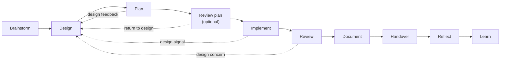

# Engineering workflows
*Last updated: 2026-10-14*

How a change travels from idea to shipped, owned code. Each phase is a separate skill and usually a separate session. Each phase answers one question, and you answer it with the AI's help.

## Choose the depth first

Not every change needs every phase. Bob scales the process to the risk of the change.

| Depth | Use when | Phases |
|---|---|---|
| 🟢 Fast | The change is local, reversible, settled and easy to verify | `/bob:dev` only |
| 🟡 Standard | The intent is clear, but the change needs a design or a plan | Start where the open question is, usually Design or Plan |
| 🔴 Full | New domain concepts, public contracts, migrations, changes across boundaries | The whole loop |

If you are not sure, describe the work. The `bob` hub rates it and recommends a depth.

`/bob:dev` checks four questions before every change. Does it add a domain concept? Does it change a contract? Does it cross a module or service boundary? Is it hard to reverse? If any answer is yes, it stops and recommends `/bob:design`.

## The loop

The dotted lines matter. When a later phase finds a conceptual problem, it goes back to Design. It is not patched locally.

At the end of each phase, bob names the next phase and why. It only recommends: you start each phase.

## Phases at a glance

| Phase | Question it answers | Output in `{story}/sessions/` |
|---|---|---|
| `/bob:brainstorm` | Is this worth building, and what outcome do we want? | `{date}-brainstorm-{slug}.md` (Brainstorm Brief) |
| `/bob:design` | What is the simplest coherent concept for this system? | `{date}-design-{slug}.md` (Design Record) |
| `/bob:plan` | What sequence of changes builds it safely? | `{date}-plan-{slug}.md` |
| `/bob:review-plan` | Does the plan hold up against the real code? | `{date}-review-plan-{slug}.md` |
| `/bob:implement` | How do we build it without losing the intent? | Code + `{date}-implement-{slug}.md` |
| `/bob:review` | Is the change correct? | `{date}-review-{slug}.md` |
| `/bob:document` | Do the architecture notes match the code? | Notes in `docs/architecture/` |
| `/bob:handover` | Can you approve the change and own it? | `{date}-handover-{slug}.md` |
| `/bob:reflect` | Do you understand what was built? | `{date}-reflect-{slug}.md` (Reflection Record) |
| `/bob:learn` | What should the AI harness learn from this? | `{date}-learn-{slug}.md` |

## Brainstorm

**Use when** the value, the outcome or the framing of an idea is open.

The AI coaches you through five steps: seed, diverge, converge, detail and commit. It challenges the idea for value. It does not decide architecture or code.

**Your job:** pick the direction and say what is out of scope.

## Design

**Use when** concepts, boundaries, naming or the fit with the rest of the system are open. Skip it when the requirement is stable and simple.

The AI reads the Brainstorm Brief, looks for concepts the codebase already has, then asks questions one at a time:

- Does an existing concept already express this?
- What new concept, if any, is needed?
- What complexity does this remove, add or move?
- Where would another developer start reading?

Short, specific answers are accepted. The AI pushes back only when a term is ambiguous, a trade-off has no owner, or your answer conflicts with the code. "Do not build" or "investigate first" are valid results.

**Your job:** own the concept. The Design Record is the intent that every later phase reads.

## Plan

**Use when** the design is owned and you need the execution shape.

The plan describes the current system, any refactoring to do first, numbered implementation steps, a testing strategy with Given/When/Then acceptance criteria, risks, and a Questions & Decisions table. An Intent Coverage table maps every requirement to a step. The plan is self-contained: someone who was not in the earlier sessions can execute it.

**Your job:** answer every row in the Questions and Decisions table. Do not continue until you agree with the plan.

## Review plan

**Use when** the risk or uncertain facts justify an independent check.

A fresh session reads the plan as someone else's work and checks it against the real codebase: wrong assumptions about the code, simpler solutions, security gaps, missing intent. It only reviews. It never edits the plan.

**Your job:** decide which findings change the plan.

## Implement

**Use when** the plan is approved and you ask for it to be built.

The AI runs the tests first to get a green baseline, then works through the steps with tests at each one. It continues alone on mechanical friction. It pauses when the code shows that the design does not fit reality, for example a new concept the design did not have, a contract change, or a test that disproves an assumption. Each pause states what it saw, where, and what decision it needs.

**Your job:** answer the pauses. The Implementation Note records every deviation and design signal.

## Review

**Use when** the change must be checked independently.

The AI finds the scope from git and checks the change against the plan, the Design Record, the guidelines and the done criteria. It looks for bugs, design drift and system health. If Ponytail is installed, it also runs an over-engineering pass. It reports, it does not fix.

**Your job:** decide what to fix. You do not have to accept every finding.

## Document

**Use when** the change touched concepts or patterns that the architecture notes describe.

`/bob:document` updates `docs/architecture/` to match the code that was built, not the design. It reports drift as questions and never fixes it silently. Only you can mark a pattern as `established`.

## Handover

**Use when** the AI wrote much of the change and you must own the result.

The Handover replaces the pull request. It tells the change in reading order, concept by concept, with the code and the reasoning at each place. Small mechanical changes are grouped into sweeps. A script checks that every changed file is in it.

**Your job:** read it, then commit it. Its commit is the starting point for the next handover.

## Reflect

**Use when** you have read the Handover, or the implementation surprised you.

A short peer conversation with two to five questions taken from evidence: parts of the change that are hard to explain, design signals that fired, smells. You answer first. The AI looks at the code with you only where an answer is vague. "No gap, ownership is clear" is a valid and common result.

## Learn

**Use when** a session showed a lesson about how the AI should work.

Learn looks at corrections, interruptions and repeated review findings. A lesson seen once is only logged in `docs/process/learnings.md`. A second occurrence makes it a candidate for a change to a skill, the repository instructions, a guideline or a script. "No lesson this time" is a common and valid result.

Name one skill ("improve plan from this session") and Learn runs in scoped mode for that skill only.

## Beside the loop

| Skill | Use when | Output |
|---|---|---|
| `/bob:investigate` | A bug needs a root cause, not a quick fix | Investigation report with fix options. It never fixes. |
| `/bob:ui-review` | A screen, flow or app needs an expert UI/UX review | Ranked findings. It implements only if you ask. |
| `/bob:dev` | A quick fix or a direct change | Code. No session artifact. |
| `/bob:explain` | You need to understand a topic, or a part of the system AI built, the way you would if you had built it | An interactive HTML page in `docs/explainers/`. Outline approved first. For humans only, never a source of truth. |

## Autopilot

`/bob:autopilot` is the exception to human-paced phases. Use it for stories whose big questions were settled in brainstorm and design, or that are small and simple. It takes the story IDs you name, or the stories in the project kanban's Ready column, and checks that each has a settled Design Record. Nothing runs until you confirm the list.

Then it runs, per story and one story at a time: plan, review-plan, plan integration, implement, review, fixes, document, commit, handover, commit. Each phase is the normal bob skill in its own subagent. Subagents answer questions only when the Design Record, intent or plan settle them, and log each answer in their artifact. A pause, a return to design or a failure stops the whole run without committing, so no later story builds on half-done work. Finished stories land in Verify: read the handover, then run `/bob:reflect`.

Progress is in `docs/process/sessions/{date}-autopilot-{slug}.md`. Say "resume autopilot" to continue an interrupted or stopped run. To continue automatically after a usage limit resets:

- Desktop: check "Auto-continue when limits reset" on the limit card. The weekly-limit card does not offer it.
- CLI: check the auto-continue setting in `/config`. For unattended runs, `CLAUDE_CODE_RETRY_WATCHDOG=1` retries rate-limited requests, and `CLAUDE_CODE_RETRY_WATCHDOG_USAGE_LIMIT_RECHECK_MS` checks when the limit lifts.

## What if...

| Situation | What to do |
|---|---|
| The plan review found a problem | Update the plan. Run the review again if the change was large. |
| You disagree with a review finding | Say why. You decide what ships. |
| Implementation paused on a design signal | Answer it, or return to `/bob:design` if the concept is wrong. |
| A "quick fix" in `/bob:dev` turned into a design question | Follow its recommendation and run `/bob:design`. |
| Autopilot stopped | Read the stop reason in the run file, make the decision, then say "resume autopilot". |
| You changed code by hand between phases | Run `/bob:review` so the artifacts match the code again. |

## Next steps

- [Skills reference](06-skills-reference.md): every skill on one page.
- [Project management](04-project-management.md): where these artifacts live.
