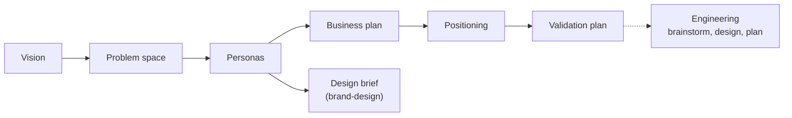

# Discovery workflows
*Last updated: 2026-10-14*

Decide what to build and why, before you build it. Discovery is optional. Use it alone for product strategy, or as the base for engineering work.

## When to use discovery

| ✅ Use it when | ❌ Skip it when |
|---|---|
| You start a new product | The vision is clear and nothing has changed |
| You are not sure the problem is worth solving | You fix bugs or build small features |
| You want to test business assumptions before you build | Discovery was done and is still current |
| The market or your customers have changed | |

## One skill, many modes

`/bob:product` is the product coach. Name a mode in your request ("write the vision", "define the personas"), or leave it open: the default coach mode checks what exists, finds gaps and moves to the right mode. Product documents have no story. They are updated in place in `docs/product/`.

| Mode | Answers | Writes |
|---|---|---|
| coach (default) | What is missing? What next? | `README.md` (the index of product docs) |
| vision | What is it, who is it for, why does it matter? | `vision.md` |
| personas | Who are the users? | `personas.md` |
| problem-space | Is the problem real and painful enough? Kill or proceed? | `problem-space.md` |
| business-plan | How do we make money? Pricing, unit economics | `business-plan.md` |
| positioning | How do we win? Competitors, differentiation, go-to-market | `positioning.md` |
| validation | Which assumptions are riskiest, and how do we test them cheaply? | `validation-plan.md` |

Two more skills sit next to it:

| Skill | Use for | Writes |
|---|---|---|
| `/bob:brand-design` | The design brief (goals, principles, tone, voice), and art direction for UI, brand and web | `docs/product/design-brief.md`, optionally `docs/guidelines/visual-design.md` |
| `/bob:linkedin` | LinkedIn strategy for consultants, founders and B2B services | - |

## Suggested order

The order is a suggestion. You can go back at any time, and most projects need only part of it.

- **Short path:** vision, personas, business plan.
- **New product launch:** all of it.

## How discovery feeds engineering

You do not repeat your strategy in every session. The skills read it from the files:

| Product file | Read by |
|---|---|
| `vision.md` | `brainstorm`, `plan`, `review-plan`, `implement`, `review`, `ui-review` |
| `personas.md`, `design-brief.md` | `ui-review`, `brand-design`, `user-guide` |
| `positioning.md`, `personas.md` | `linkedin` |

## When you change your mind

Run the mode again, for example "update the personas". The product documents describe what you believe today. When you learn something new, update them. Engineering skills read the new version in their next session.

## Next steps

- [Engineering workflows](02-engineering-workflows.md): build what you decided.
- Not sure where to begin? Run `/bob:product` with no mode.
