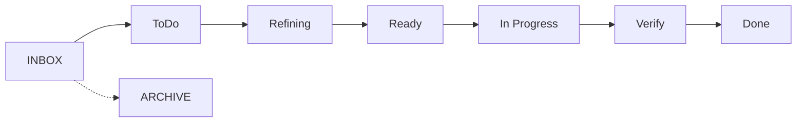

# Project management
*Last updated: 2026-10-14*

Bob tracks work in stories and kanban boards, all as markdown files in `projects/`. The boards render as interactive boards in Obsidian with the Kanban plugin. Without Obsidian they are plain, readable markdown.

## Sub-projects

`projects/` holds one product, split into concerns. Each sub-project has its own board and its own story numbers:

```
projects/
├── _index.md     lists all sub-projects
├── APP/          app development    → APP-001, APP-002 ...
├── WEB/          website            → WEB-001 ...
└── BUS/          business           → BUS-001 ...
```

One sub-project is enough for a simple product. Keep prefixes short (2-4 letters) and stable. A renamed prefix breaks links.

## Inside a story

```
projects/{SUB}/stories/{ID}/
├── _index.md      the story hub: what, why, current state, intent sources, history
├── _notes.md      your free-form notes
├── _kanban.md     the task board for this story
├── input/         original requirements and request recaps
├── sessions/      dated artifacts: {date}-{type}-{slug}.md
└── tasks/         one file per task
```

Bob creates all of this in one go when you say "new story", or when a phase needs a story and none exists. Do not create story folders by hand.

When a requirement exists only in the conversation, bob writes a complete recap to `input/{date}-request.md`. It shows you the recap first and saves it after you confirm. Later phases read these originals, not summaries of them.

## The boards

### Project board: stories



| Column | Meaning |
|---|---|
| INBOX | Ideas that nobody has committed to |
| ToDo | Committed, not started |
| Refining | Being brainstormed or designed |
| Ready | Design settled, ready to plan and build (`/bob:autopilot` picks stories from here) |
| In Progress | Being planned and built |
| Verify | Built and handed over, waiting for your sign-off |
| Done | Shipped and verified |
| ARCHIVE | Dismissed or deferred |

### Story board: tasks and issues

Columns: Issues, todo, Ready, in progress, Verify, done. Task cards link to files in `tasks/`. Issues are plain checkboxes with a severity icon:

```markdown
## Issues
- [ ] 🔴 Auth token not cleared on logout
- [ ] 🟡 Replace hardcoded role strings with an enum
- [ ] 🟢 Extract magic numbers to constants
```

## Who updates what

| Event | Bob does | You do |
|---|---|---|
| A phase writes an artifact | Adds a row to the story's History table, at once | Read it |
| A phase starts on a task | Moves the task card to `in progress` | Confirm the task if bob asks |
| A task is finished | Moves the card to `done` | - |
| Work is discovered (bugs, debt, ideas) | Proposes where to file it and asks once | Say yes, no, or which items |
| The story is in progress | Moves the story card, sets `status` in `_index.md` | - |
| The story is done or dismissed | Moves the card and the folder to `archive/done/` or `archive/dismissed/` | Decide that it is done |

You can always move cards by hand in Obsidian. Do not edit the History table by hand: bob keeps it.

## Where discovered work goes

Bob routes each item of discovered work by type when it shows up:

| Discovered work | Goes to |
|---|---|
| The design does not fit reality | Back to the Design Record, or to `/bob:design` |
| An issue in this story's scope | The story board, `Issues` column |
| Anything else | The project board, `INBOX`. A likely new story is marked `[Story candidate]` |
| A lesson about how the AI should work | `docs/process/learnings.md`, for `/bob:learn` |

## The `bob` hub as project mentor

Ask "where are we, what next?" or run `/bob:bob`:

| Ask for | You get |
|---|---|
| Where am I (default) | The state of the active story and the next phase. Without a story: what is in flight, ready or blocked, and one recommendation |
| Which phase | The skill that fits your work, and why that one |
| Start a new session | Which files to load, and which to leave out |
| A status report | A written report: foundation, recent activity, gaps, next session |

It can also append a short status to `personal/daily/{date}.md`.

## Dependencies between stories

Write them in the story's `_index.md`:

```markdown
## Blocked By
- [APP-001](../APP-001/_index.md) - needs the auth system first
```

Keep a blocked story in ToDo until the dependency ships.

## Tips

- `_notes.md` is yours. Write gotchas, code pointers and loose decisions there.
- After weeks away, open the story's `_index.md`. The History table links to everything.
- Archive, do not delete. The archive answers "why didn't we do X?".

## Next steps

- [Engineering workflows](02-engineering-workflows.md): the phases that fill a story.
