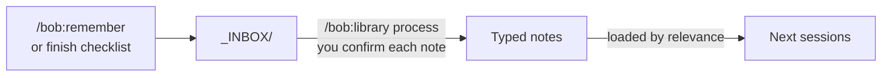

# Knowledge management
*Last updated: 2026-10-14*

What the project knows lives in files, so every new session starts informed. Each kind of knowledge has one home.

## Where knowledge lives

| Store | Answers | Written by | Loaded |
|---|---|---|---|
| `docs/domain/` | What do our terms mean? | The hub, when you correct or clarify a term | By the terms the work uses |
| `docs/architecture/` | How does the system work now: concepts and patterns | `/bob:document` | Index first, then notes in scope |
| `docs/guidelines/` | What are the pitfalls of our technologies? | `/bob:guidelines` | By file type, path and phase |
| `docs/product/` | What are we building, for whom, why? | `/bob:product`, `/bob:brand-design` | By the phase's needs |
| `knowledge/` | What have we learned that fits nowhere more specific? | `/bob:remember`, `/bob:library` | By relevance, at most 5 files |
| `docs/process/learnings.md` | Which lessons about the AI have we seen once? | The finish checklist, `/bob:learn` | By `/bob:learn` |

Rule of thumb: the current state goes in `docs/`, what happened goes in the story, and reasons that outlive a story go in `knowledge/`.

Every folder has a `README.md` index. Bob reads the index first and loads only the files that match the work. It never loads a whole folder.

## Domain terms

When you correct the AI on what a term means, the hub's finish checklist offers to record it in `docs/domain/`. It writes nothing until you confirm. Later sessions use the term as defined there, in artifacts and in code names.

## Architecture notes

`/bob:document` keeps `docs/architecture/` in step with the code. It writes small, linked notes, one per concept or pattern:

```
docs/architecture/
├── README.md     index: one line per note, with "Read when"
├── concepts/     what the system does, concept by concept
└── patterns/     how this codebase solves recurring problems
```

| Mode | Use when |
|---|---|
| Discover | The project has no notes yet. Bob proposes concept and pattern lists. You confirm, rename or drop items before it writes. |
| Update | After Review. The notes are changed to match what was built. |
| Audit | On request. Bob checks the notes and the rest of `docs/` for drift. |

Patterns have a status: `emerging`, `competing` or `established`. Only you can promote a pattern to `established`.

## Guidelines

`/bob:guidelines` writes short guidelines in `docs/guidelines/` for the project's languages and frameworks. It researches official sources first, then reads your code. A guideline holds only project-specific rules. If an installed skill already covers a topic, the guideline does not repeat it.

Write a guideline when a pitfall has bitten you more than once, not before.

## The knowledge vault

The vault in `knowledge/` holds decisions, research and insights as small, typed notes.

| Folder | Holds |
|---|---|
| `decisions/` | Decisions with their reasons |
| `concepts/` | Terms and ideas worth defining |
| `research/` | External findings, benchmarks, tool evaluations |
| `practices/` | Ways of working that proved themselves |
| `sources/` | Original source material, linked from notes |
| `_MOC/` | Maps of content for clusters of notes |
| `_INBOX/` | Raw captures, waiting to be filed (gitignored) |

### The capture flow



1. **Capture now.** `/bob:remember We avoid X because of Y` writes to `_INBOX/` at once, with no questions.
2. **File later.** `/bob:library process` proposes how each item becomes a note: create, merge, enrich or split. You confirm each one.
3. **Forget about it.** Engineering sessions search the vault and load the relevant notes themselves.

### Library modes

| Call | Does |
|---|---|
| `/bob:library` | Status: inbox count, notes, what to do next |
| `/bob:library process` | Files the inbox into notes |
| `/bob:library ingest <url-or-file>` | Turns an external source into notes |
| `/bob:library retrieve <query>` | Searches the vault |
| `/bob:library organise` | Health check: broken links, orphans, tags, maps of content |

The first run of `/bob:library` or `/bob:remember` creates the vault if it does not exist.

## Next steps

- After your first feature ships, run `/bob:document`.
- When you learn something worth keeping, run `/bob:remember`.
