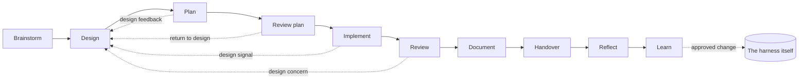
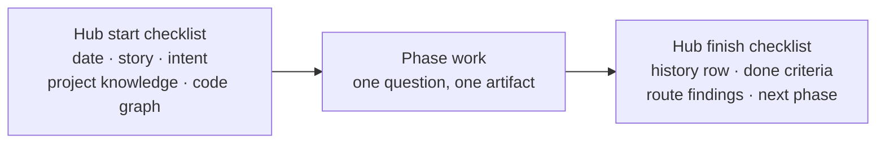
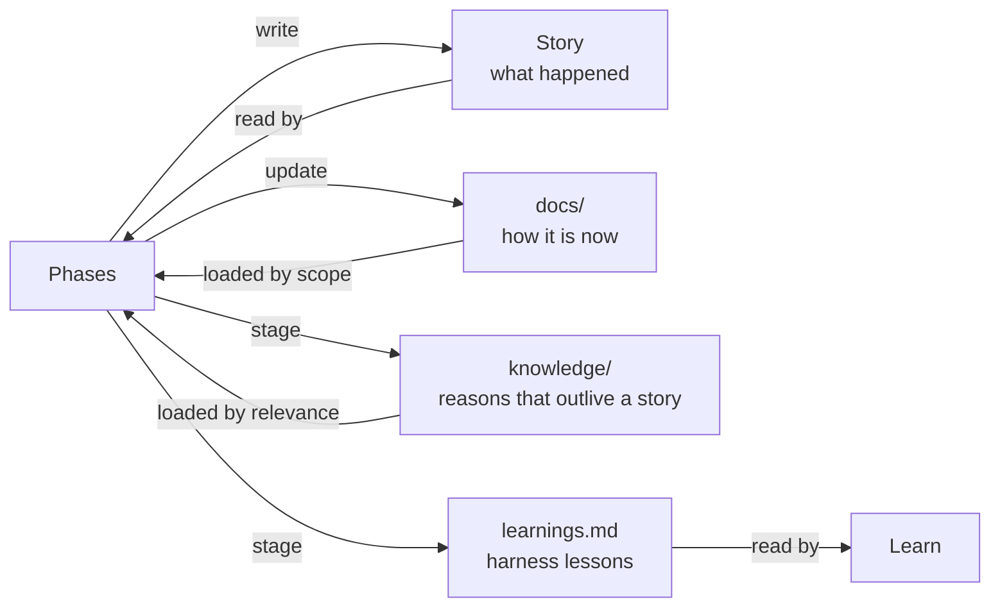

# Appendix: the design of bob
*Last updated: 2026-10-14*

This appendix explains why bob is built the way it is. It is for people who want to build their own AI development framework, and for teams I work with in workshops.

## TL;DR

- Bob is about a year of my own failures with AI-assisted development, turned into skills, files and checklists.
- The goal is human ownership of the code, not speed. Speed is welcome, but it must not be the only thing that improves.
- Nine principles carry the design. The skills are only one way to express them.
- Please don't copy bob. Copy the questions it answers, and build the answers that fit your team.

## Please don't copy this

When I run AI kickoff workshops for teams, I use bob as an example, and I always say the same thing: don't install my framework and call it your process.

A copied framework starts to drift the day you adopt it. The team can't tell which parts are essential design and which are historical accident, so nobody dares to change anything, and nobody improves it either. The models, the tools and your codebase all keep changing, so the harness has to change with them. A team should own its AI harness for the same reason it owns its architecture: both encode decisions with real consequences.

So read this as a reference design. Take the principles you agree with, challenge the ones you don't, and build something your team understands well enough to change.

If you want help doing that on your own codebase, that is what my [AI Team Kickoff](https://bofrese.dk/ai/team-kickoff.html) is for: two days on your code, with your use cases, and then I stay for an agreed period until it runs on its own. More about my AI work: [bofrese.dk/ai](https://bofrese.dk/ai/).

## Where bob came from

Two months into building my own product entirely with AI, I asked for a feature that should have taken an hour. The AI went in circles. It wasn't confused about the feature, it was confused about which version of my system it was talking to, because every session had made its own locally reasonable decision and none of them remembered the last one's choice.

I hadn't noticed, because features that used to take days were landing in hours, and reviewing carefully felt like the thing slowing down the fun. I ended up rebuilding the core of the system by hand, and then I scrapped the project. Months later I scrapped a second one for the same reason.

The model was fine. What was missing was everything around the model: context, decisions, verification, and a human who still understood the system. Bob is what I built to put those back, one painful lesson at a time.

## The problem bob solves

An AI agent has defaults, and left alone, each default wins.

| AI default | What it does to a project | Bob's counter-move |
|---|---|---|
| 📉 It writes like the average programmer | Competent code, rarely principled code | Load the right principles at the right moment, per phase |
| 🙂 It is a pleaser | It agrees with you, more so the longer the conversation runs | Fresh sessions review earlier work as someone else's work |
| 🧠 Every session is day one | It re-guesses your conventions, and guesses differently each time | Files in git hold the memory, loaded by scope |
| 🏃 It is fast and solution-first | Code grows faster than anyone's understanding of it | Phases that keep the human thinking, and an explicit ownership transfer |

The last row is the one that matters most to me. I call it unearned velocity: the speed of implementation outpaces the understanding needed to maintain what gets built. Technical debt announces itself, the code gets ugly and everyone complains. Understanding debt is silent. The system works, velocity looks good, and the number of people who could confidently change it falls quietly.

## The north star: you own the code

The industry says "keep a human in the loop". I don't think that is enough. Being in the loop can mean clicking approve on things you no longer understand. The human has to keep ownership: be able to explain the design, debug it, change it, and take responsibility for it, even if the AI typed most of it.

That leads to the one distinction everything else in bob builds on. Some work is mechanical weight: typing, boilerplate, wiring, running the checks. Hand that to the AI aggressively and without guilt. Other work is the reps that build engineering judgment: framing the problem, choosing the concepts, deciding the trade-offs. Nobody can do your push-ups for you, so bob keeps your hands on those.

## Nine principles

The principles build on each other in this order. Each one solves a problem that the previous one creates or leaves open: separate phases need files between them, files need careful loading, and so on down to the last one, which keeps the whole thing light enough to use.

### 1. Separation of intent: one phase, one question

When one conversation does everything, one activity quietly makes a decision that belongs to another. A brainstorm decides the architecture on the way past. An implementation rewrites the design at line 400 because the design became inconvenient. A reviewer defends the code it wrote an hour ago.

So bob splits the work into phases, and each phase is allowed to want exactly one thing:

| Phase | The one question it answers | How the AI behaves |
|---|---|---|
| Brainstorm | What is worth solving? | Socratic: asks, never decides |
| Design | What is the simplest coherent model that solves it in this system? | Socratic, grounded in repository evidence |
| Plan | What sequence of changes realises that design safely? | Assertive, because you have made the decisions |
| Implement | How do we build it without losing its intent? | Close to autonomous, interrupts on surprises |
| Review | Is the change correct? | Sceptical, works against the diff |
| Reflect | What did building this teach us about the system? | Turns the questions on you, not the code |
| Learn | What should our AI harness learn from this session? | Treats the whole session, your corrections included, as evidence |

One line holds most of it: let the AI be Socratic in design and proactive in implementation. Almost everything that goes wrong is one of those two the wrong way round. An AI that is proactive in design hands you an architecture you didn't choose. An AI that is Socratic in implementation asks your opinion about the wording of an error message.

Every significant feature gets challenged twice: once for value in Brainstorm, and once for conceptual integrity in Design. A feature that survives only the first gets built as a special case. A feature that survives only the second is elegant, and nobody needed it.

### 2. Files are the memory

Separate phases only work if something travels between them. In bob that is always a file in git, never the chat history.

This gives you three things at once. Context survives a closed laptop, a new day and a new colleague. Decisions are versioned with the code, so a year later you can read why something was built. And the most important one: a fresh session can review a plan it did not write. Long conversations build up momentum, and the AI grows more agreeable the longer it runs. A new session that reads the plan as "someone else's work, review it critically" gives you real critique.

Bob keeps two kinds of files apart, because they age differently:

- Living documents describe how things are now and are edited in place: `docs/product/`, `docs/architecture/`, `docs/guidelines/`.
- Dated session artifacts record what happened in one phase and are never rewritten: `projects/{sub}/stories/{ID}/sessions/`.

Readers of `docs/` get the current truth. Readers of a story get the path that led to it.

Each artifact has two readers: the next phase's agent, and a human who skims. So every artifact starts with a short TL;DR, uses tables for comparisons, and cites file paths as evidence. Markdown fatigue is real, but I still prefer it to approval fatigue.

### 3. Context is infrastructure

The files that tell an agent what your project is and how you work are load-bearing. I test them with the new-employee test: could an experienced developer who reads fast get up to speed from these files in minutes? If not, neither can the agent.

More context is not better, though. Every phase loads the minimum it needs for its own judgment, and nothing more. In bob each phase skill declares this in one `Loads:` line, for example:

```text
Loads: hub story, intent, project-knowledge, code-graph; story design; files docs/product/vision.md
```

Every knowledge folder has a small index (`README.md`), and the loader reads the index first, then only the notes that match the scope. Skills follow the same idea: a short `SKILL.md` that says when to read which reference file, so most of the guidance stays on disk until a mode needs it.

I also keep two kinds of context apart. Skills describe how to do a kind of work, and they are the same in every project. Project knowledge (domain terms, architecture notes, guidelines, product docs) describes this project, and it lives in the project's own repository, owned by the team.

### 4. Intent survives the engineering loop

This one I learned the hard way. When the design summarised the brainstorm, and the plan summarised the design, requirements got lost a little at each step, like a game of telephone.

Bob now never rewrites intent as a new summary. Current intent is the original sources (the request, the documents the user supplied) plus an ordered list of explicit changes, each with a reason and a name on it. The plan has an Intent Coverage table that maps every intent item to a plan step, the plan review checks it, and the implementation verifies it as its last step. Anything no change row touches still applies.

### 5. Implementation is a sensor

A design looks right on paper and breaks on real code. Implementation is the first moment that shows, so bob treats it as a sensor for whether the design fits reality.

The implement skill separates mechanical friction (keep going) from evidence that the conceptual model is wrong (stop and talk). A pause has to carry its evidence: what was observed and where, which design assumption it breaks, and what decision is needed. Hiding a surprise behind an adapter, a flag or a special case is forbidden.

The loop therefore has routes back. Any later phase that finds a conceptual problem returns it to Design instead of patching it locally.



### 6. Ownership transfer is a phase

You can't outsource ownership or responsibility to an AI, and reviewing pull requests doesn't create ownership either. A diff is ordered by file name, not by idea, and approval fatigue does the rest.

So bob makes the transfer explicit, in two steps:

1. **Handover** narrates the whole change in reading order, concept by concept, with the code shown and the reasoning at each place. A script checks that every changed file appears. Approving the Handover replaces approving a pull request.
2. **Reflect** is a short peer conversation after you read it. Two to five questions picked from evidence: parts of the change that are hard to explain, design signals that fired, smells. You answer first. "No gap, ownership is clear" is a valid and common result.

Review, Reflect and Learn look similar from a distance, and the temptation to merge them comes early. Don't. Review attends to the change, Reflect to your understanding, Learn to the workflow. Ask one agent to hold all three stances and it picks the easiest one, which is Review, every time.

### 7. The harness learns, slowly

Every correction you make to an agent is a candidate rule. If every candidate becomes a rule, the harness bloats, gets slow and starts to contradict itself. I call this instruction accretion, and I have done it.

Bob's Learn phase has a high bar. A lesson seen once is only logged in `docs/process/learnings.md`. The second credible occurrence makes it a candidate. Every candidate states its cost before it is recommended, and executable enforcement (a script, a test, a hook) beats another paragraph of instructions. Most sessions teach the harness nothing durable, and that is a successful result.

### 8. AI proposes, human promotes

The AI drafts and proposes. A human confirms before anything becomes durable or authoritative: a new rule in a skill, a domain term, an architecture pattern marked `established`, a note filed in the knowledge vault. A wrong AI promotion spreads, because later work trusts it.

Low-risk capture is the exception. A quick note to the vault inbox is written straight away, and reviewed later when it is processed.

### 9. Small work stays small

A discipline that can only run at full weight ends up applied to nothing. Run a ten-phase ceremony for a two-line fix and you have built bureaucracy, and nobody will keep doing it, me included.

Bob has three depths. The fast path (`dev`) skips the loop entirely. Before every change it asks four questions: does this add a domain concept, change a contract, cross a boundary, or is it hard to reverse? Any yes, and it recommends Design instead. Standard work starts at the phase where the open question actually is. Only conceptually significant work runs the full loop.

## The mechanisms that hold it together

Principles are easy to agree with and hard to apply every time. These mechanisms are what make bob behave the same way on the tenth feature as on the first.

### One skeleton for every phase

Every phase skill runs the same shape. Only the middle differs.



The shared start and finish steps live in one hub skill, and each phase invokes it by name. A fix to how context loads, or to how work is closed, is made once. This is the main reason the skills build on each other instead of drifting apart.

### The finish checklist closes the loop

Sessions used to end without recording anything, so state was lost. Now every phase ends the same way: register the artifact in the story history, check the project's done criteria, route discovered work to the right kanban, capture corrected domain terms, stage knowledge candidates, and name the next phase. Nothing is persisted without your confirmation.

### Knowledge stores with one job each

Each kind of knowledge has exactly one home, so the agent never has to guess where to look or where to write.



This is the flywheel. Every phase leaves the project a little better described, so the next session starts better informed.

### Scripts for deterministic steps

Some steps have exactly one correct answer: today's date, which story a file belongs to, which files changed, whether the handover covers every one. An LLM is slower at these, costs tokens and sometimes gets them wrong. Bob does them with small Python scripts, each with a self-test. Judgment (classify, narrate, review) stays with the model.

### Quiet when something is missing

Optional integrations (Obsidian, a code graph, a daily-notes folder) are used when present and skipped silently when absent. A framework that nags about missing extras gets uninstalled.

### An always-on primer

Skills only load when the agent decides to use them. A user who just says "fix this test" would otherwise get no story, no project knowledge and no finish checklist. A few lines injected at session start tell the agent that the repository uses bob and where its knowledge lives. You don't have to remember any skill names.

### Portable by default

Every skill follows the open Agent Skills format. Claude Code specifics (the session hook, the plugin manifest) live in thin adapters outside the skills, so the same skill folders can work in other coding agents.

## Building your own

Here is the order I suggest to teams. Add one piece at a time, and check whether it changed anything before you add the next.

1. **Write down the project context.** Domain terms, the main concepts, the conventions that matter. Run the new-employee test on it.
2. **Separate planning from implementing.** Plan in one session, implement in another, with the plan as a file between them.
3. **Add a fresh-session review.** Compare a review by the session that wrote the code with a review by a fresh one. The difference is usually visible the first week.
4. **Add Design before Plan**, for significant features only. Watch whether the plans get simpler and whether developers feel more ownership of the result.
5. **Add an explicit ownership step**, something like Handover and Reflect, on a few meaningful features. Ask developers directly whether it surfaced anything.
6. **Add Learn.** Track the corrections people keep making to the agents, and check whether persisting them reduces the repetition.
7. **Tune autonomy.** Decide which implementation work can be delegated safely in your codebase, and which signals must interrupt a human.

For every piece you add, you should be able to answer four questions:

- ❓ Which AI default or human risk does this counter?
- ❓ How would we notice if it stopped working?
- ❓ What does it cost per session, in time and tokens?
- ❓ When would we remove it?

If nobody on the team can answer those for a piece of your framework, you don't own that piece yet.

## Further reading

- [bofrese.dk/ai](https://bofrese.dk/ai/) - my AI work, articles and talks.
- [AI Team Kickoff](https://bofrese.dk/ai/team-kickoff.html) - two days on your own codebase to build your team's AI development process.
- [bob.bofrese.dk](https://bob.bofrese.dk/) - the bob homepage and presentation.
- [Engineering workflows](02-engineering-workflows.md) - how the phases run in practice.

What would your team's version of this look like?
