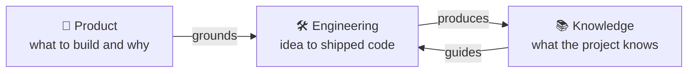

# Bob user guide
*Last updated: 2026-10-14*

Bob is a Claude Code plugin of Agent Skills for AI-assisted product development, from the first idea to shipped, tested and documented code. The AI does the mechanical work. You make the decisions and keep ownership of the code.

## Where to start

| If you want to...                                | Read                                                   | Main skill                    |
| ------------------------------------------------ | ------------------------------------------------------ | ----------------------------- |
| 🚀 Install bob and run a first session           | [Getting started](01-getting-started.md)               | `/bob:setup`                  |
| 🛠️ Build a feature or fix a bug                 | [Engineering workflows](02-engineering-workflows.md)   | `/bob:brainstorm`, `/bob:dev` |
| 🧭 Decide what to build and why                  | [Discovery workflows](03-discovery-workflows.md)       | `/bob:product`                |
| 📋 Track stories and tasks                       | [Project management](04-project-management.md)         | `/bob:bob`                    |
| 📚 Keep docs and knowledge in sync with the code | [Knowledge management](05-knowledge-management.md)     | `/bob:document`               |
| 🔎 Look up a skill                               | [Skills reference](06-skills-reference.md)             | -                             |
| 🩹 Fix something that does not work              | [Troubleshooting](07-troubleshooting.md)               | -                             |
| 💡 Understand why bob is built this way          | [Appendix: the design of bob](08-design-philosophy.md) | -                             |

## How bob fits together

Bob has three layers. Each is useful alone, and they work better together.



## Three ideas to know

- **You decide, the AI explores.** The AI generates options, surfaces trade-offs and challenges your assumptions. You choose the direction, and nothing ships without your sign-off.
- **Files are the memory.** Every skill writes its result to a known file in your repository. You can close the laptop, come back tomorrow or hand over to a colleague, and the context is still there. A fresh session can then review earlier work honestly, without the momentum of the conversation that produced it.
- **Just describe your work.** In a project that uses bob, a short primer at session start points the AI to the `bob` hub skill. The hub picks the fitting phase, so you do not need to remember skill names.

## Quick start

1. Install bob in Claude Code:
   ```
   /plugin marketplace add bofrese/claude-plugins
   /plugin install bob@bofrese-plugins
   ```
2. Open Claude Code in your project folder.
3. Run `/bob:setup` once. It creates the folders bob uses, after one confirmation.
4. Describe what you want to do, or ask "Bob, where are we and what next?".
5. Read what bob writes and push back. It is a first draft, not the final answer.

Next: [Getting started](01-getting-started.md).

## About this guide

The guide describes what bob does today. If you find a gap between the guide and what happens, open an issue on [GitHub](https://github.com/bofrese/bob). Gaps in the guide often point to gaps in bob.
