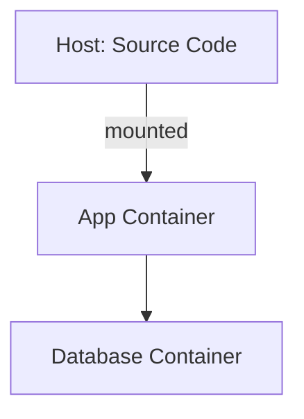

# Setup log template

Write to `ai/docker/{date}-docker-setup.md` (create `ai/docker/`).

````markdown
# Docker Setup Log
**Date:** {YYYY-MM-DD}
**Project:** {name}
**Stack:** {detected languages/frameworks}

## TL;DR
{3-6 bullets: what runs, how to start it, what failed or is open.}

## What Was Done
Summary of files created or modified.

## Docker Architecture
Overview of the container setup - services, volumes, ports, networking.



## Makefile Commands
| Command | Description |
|---------|-------------|
| `make setup` | ... |
| `make run` | ... |
| ... | ... |

## Initial Data
What seed data or initialization was set up.

## Verification Results
What was tested and whether it passed.

| Check | Result |
|-------|--------|
| Docker build | ✅ / ❌ |
| App starts | ✅ / ❌ |
| Database initialized | ✅ / ❌ |
| Tests pass | ✅ / ❌ |
| Source mounting works | ✅ / ❌ |

## Known Issues / Caveats
Anything the developer should be aware of.
````
